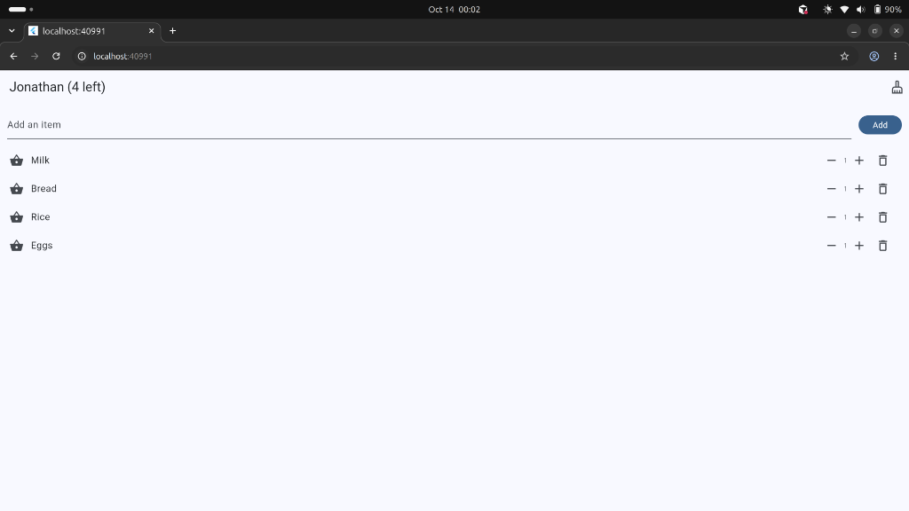
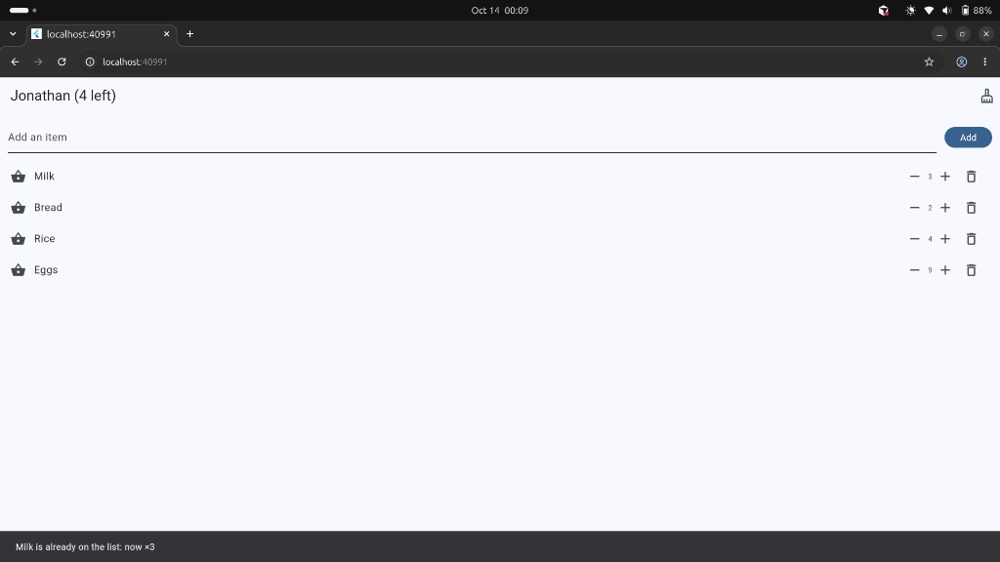
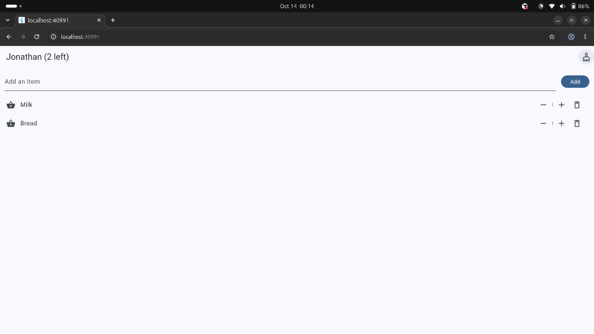
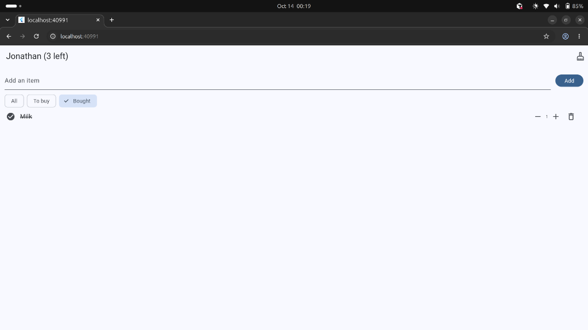
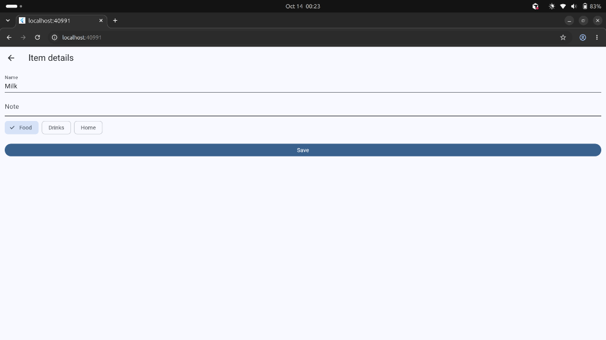

# Shopping List

A shopping list: type an item, tap Add, mark it bought, and delete it.

Mukunzi Jonathan · 27132

## Features

1. An empty list says **Your list is empty**.
2. Every item has a quantity, with **−** and **+**. The quantity never goes below 1.
3. Adding a name that is already on the list raises its quantity instead of adding a second row.
4. Deleting an item shows **Undo**, and Undo puts it back in the same place.
5. **All**, **To buy**, and **Bought** filter the list. Bought items sit at the bottom of All.
6. A long-press opens **Item details**. Save keeps the name, note, and category. The back arrow changes nothing.

## Screenshots

## Think

1. With a filter on, the row number is a position in `shown`, not in `items`. Deleting by that index removes a different item. The fix is to delete the item itself: `items.remove(item)`.

2. `name` had to stop being `final` because the details screen renames the item. `final` is still right for a value that must be set once and never changed.

3. Hot reload keeps the `Item` objects that were already created, before `quantity` existed. A hot restart throws those objects away and builds new ones that have the field.

4. The details screen changed the same `Item` object, but the list does not redraw on its own. Flutter redraws a screen when that screen calls `setState`. The `.then` after `Navigator.push` runs when the user comes back, and its `setState` is what tells the list to redraw.
