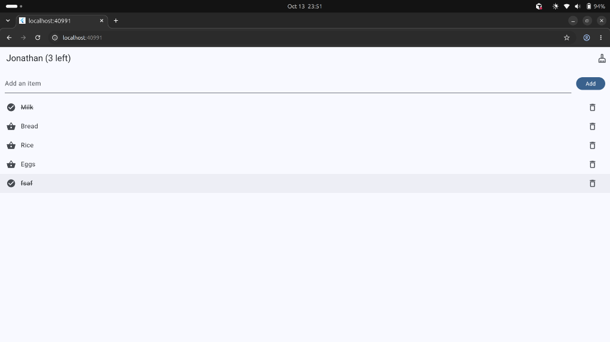

# Shopping List

A shopping list: type an item, tap Add, mark it bought, and delete it.

Mukunzi Jonathan · 27132

## Screenshots

Later screenshots, saved in `screenshots/`:

| Part | File |
|---|---|
| 2. Quantities | `screenshots/quantities.png` |
| 4. Undo | `screenshots/undo.png` |
| 5. Bought filter | `screenshots/bought-filter.png` |
| 6. Item details | `screenshots/item-details.png` |
